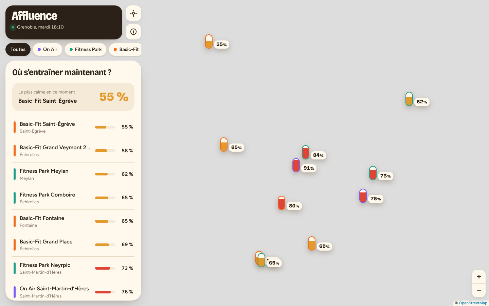
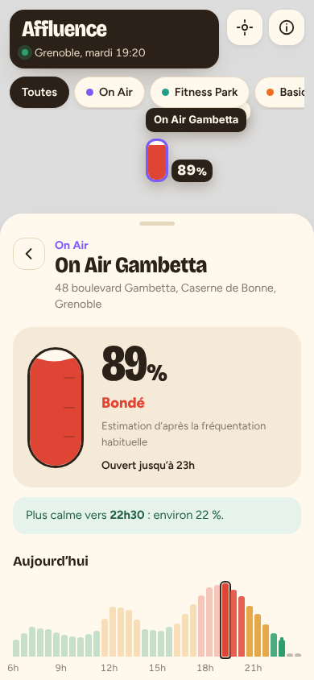

# Affluence

**La carte en direct de l’affluence dans les salles de sport de Grenoble.**
On Air, Fitness Park, Basic-Fit : en un coup d’œil, tu vois quelle salle est calme maintenant, à quelle heure elle se vide, et tu signales toi-même comment c’est sur place, façon Waze.

<p align="center">
  
  
</p>

## Ce que fait l’app

- **Carte des salles** : chaque salle est une petite jauge qui se remplit selon l’affluence (vert calme, orange ça se remplit, rouge bondé).
- **Le plus calme en ce moment** : la liste trie les salles ouvertes de la plus vide à la plus pleine, avec la distance si tu te localises.
- **Fiche salle** : taux de remplissage, horaires, meilleur créneau dans les prochaines heures, et la fréquentation habituelle de la journée, demi-heure par demi-heure.
- **Signalements en direct** : sur place, un tap sur « Calme », « Normal » ou « Plein ». Le taux passe en direct et tout le monde le voit.
- **Installable sur iPhone** (PWA) : Safari → Partager → « Sur l’écran d’accueil ».
- **Liens partageables** : `?salle=onair-gambetta` ouvre directement la fiche d’une salle.

## Comment le taux est calculé

1. **Estimation** : sans signalement récent, le taux vient d’un modèle de fréquentation (courbes semaine / week-end, lundi plus chargé, vendredi soir plus calme), ajusté par salle.
2. **Direct** : chaque signalement compte pendant 1 heure et son poids est divisé par deux toutes les 20 minutes. Le modèle garde un petit poids pour lisser les signalements isolés.
3. **Anti-spam** : un signalement par salle toutes les 10 minutes et par appareil.

Le calcul est dans [`src/lib/occupancy.ts`](src/lib/occupancy.ts) et testé dans `occupancy.test.ts`.

## Stack

| Rôle | Outil | Coût |
|---|---|---|
| Interface | React 19 + TypeScript + Vite | 0 € |
| Carte | Leaflet + tuiles OpenStreetMap | 0 € |
| Signalements partagés + temps réel | Supabase (offre gratuite) | 0 € |
| Hébergement | Vercel / Netlify / GitHub Pages | 0 € |
| Polices | Bricolage Grotesque, Figtree (auto-hébergées) | 0 € |

## Lancer en local

```bash
npm install
npm run dev        # http://localhost:5173
npm test           # tests du modèle
npm run build      # version de production dans dist/
```

Pour simuler un autre moment (démo, tests) : `?heure=2026-11-17T18:30%2B01:00`.

Sans configuration, l’app tourne en **mode démo** : tes signalements restent sur ton appareil.

## Brancher les signalements partagés (Supabase, gratuit)

1. Crée un projet sur [supabase.com](https://supabase.com).
2. Dans **SQL Editor**, exécute [`supabase/schema.sql`](supabase/schema.sql) (table, règles d’accès et temps réel).
3. Dans **Project Settings → API**, copie l’URL et la clé `anon` publique.
4. Copie `.env.example` en `.env` et remplis les deux valeurs (en local), ou ajoute-les comme variables d’environnement chez ton hébergeur.

## Déployer sur Vercel

1. Importe le dépôt sur [vercel.com/new](https://vercel.com/new) (framework détecté : Vite).
2. Ajoute `VITE_SUPABASE_URL` et `VITE_SUPABASE_ANON_KEY` dans les variables d’environnement.
3. Déploie, puis ouvre l’URL sur ton iPhone et ajoute-la à l’écran d’accueil.

## Ajouter une salle

Tout est dans [`src/data/gyms.ts`](src/data/gyms.ts) : nom, adresse, coordonnées `[longitude, latitude]`, horaires et un facteur de popularité.

> Les coordonnées actuelles sont approximatives et les horaires viennent des fiches publiques des enseignes : à vérifier et affiner salle par salle. Les contributions sont bienvenues.

## Feuille de route

- [ ] Vérifier positions et horaires de chaque salle
- [ ] Ajouter d’autres enseignes (L’Appart Fitness, Freedom Fitness, salles indépendantes)
- [ ] Apprendre les courbes réelles de chaque salle à partir des signalements
- [ ] Notification « ta salle vient de se vider »
- [ ] Étendre à Lyon, Chambéry, Annecy

## Licence

MIT, Mouad El Kbabty.
Projet indépendant, sans lien avec les enseignes citées. Les taux affichés sont des estimations et des signalements d’utilisateurs.
